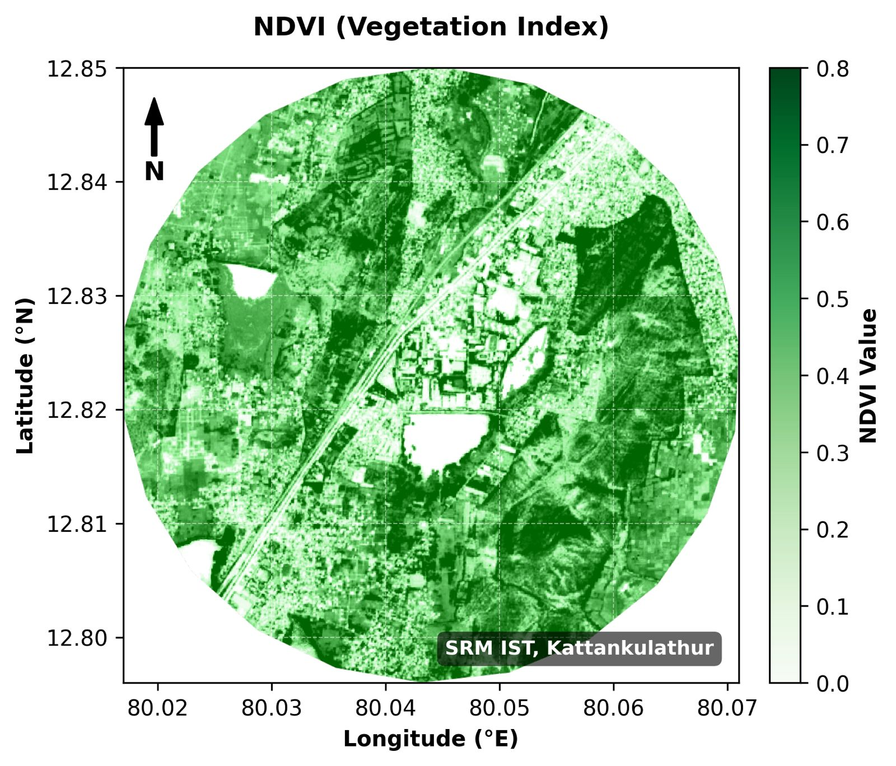
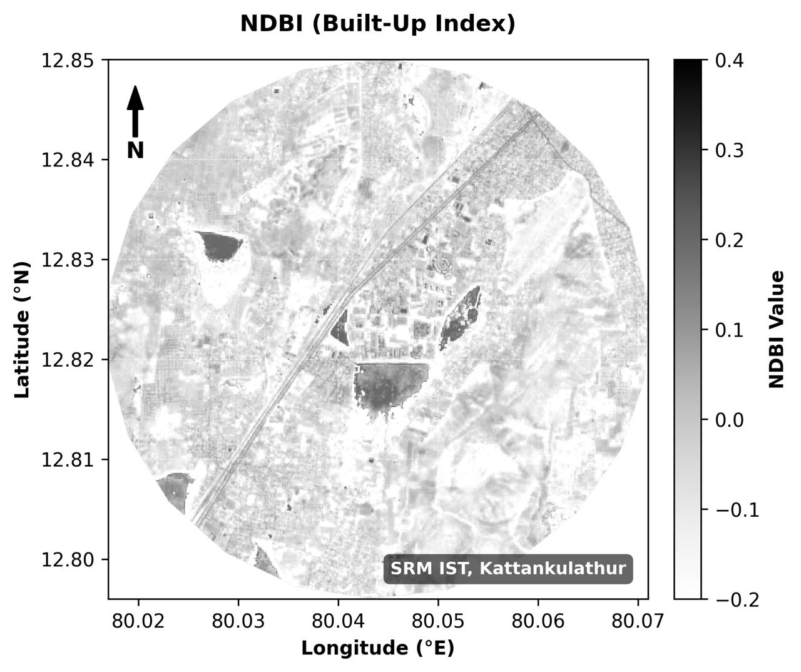

# Multisensor Data Fusion for Urban Heat Island Analysis

**AI-driven satellite data fusion for identifying and prioritizing urban cooling interventions**

A Streamlit application that fuses Sentinel-2 optical and Landsat-8 thermal satellite data via Google Earth Engine to map Urban Heat Island (UHI) intensity and automatically recommend evidence-based cooling interventions — cool roofs, solar PV zones, and afforestation sites — at 10 m spatial resolution.

This repository implements the method published in:

> R. Mahara, K. Tandon, and C. Venkatesh, **"AI-Driven Satellite Data Fusion for Urban Heat Island Mitigation,"** *Proceedings of the 7th International Conference on Inventive Research in Computing Applications (ICIRCA 2026)*, IEEE, pp. 453–460, 2026.

[](https://www.python.org/)
[](https://streamlit.io/)
[](LICENSE)

---

## Results at a glance

| Metric | Value |
|---|---|
| Random Forest overall accuracy | **91.3%** (Kappa = 0.88) |
| vs. SVM (RBF) baseline | 87.2% OA |
| vs. Naïve Bayes baseline | 83.6% OA |
| Misclassification reduction from sensor fusion | **18.4%** vs. best single-sensor baseline |
| Rooftop false-positive reduction from GLCM texture | **23.1%** |
| Study area | SRM IST campus, Kattankulathur, India (12.82°N, 80.04°E) |

| Intervention Zone | Area | Estimated Impact |
|---|---|---|
| Cool Roofs | ~45,000 m² | LST reduction: 3–5 °C |
| Solar PV Potential | ~72,000 m² | Capacity: ~10,800 kW |
| Afforestation | ~38,000 m² | CO₂ offset: 83,600 kg/yr |

---

## System architecture

The pipeline runs five sequential stages — data acquisition, pre-processing, classification, decision-level fusion, and results delivery — entirely inside Google Earth Engine before rendering in Streamlit.


---

## How it works

1. **Multi-sensor acquisition** — Sentinel-2 SR Harmonized (10 m, bands B2–B4, B8, B11, B12) and Landsat-8 Collection 2 Level-2 thermal data (Band ST_B10, 30 m) are pulled for the region of interest via Earth Engine, with cloud masking below 30% cover.
2. **Feature engineering** — NDVI and NDBI are computed and combined with the six raw bands into an 8-dimensional feature space, improving built-up/bare-soil spectral separability by 18.4% over either sensor alone.
3. **Random Forest classification** — A 50-tree Random Forest (chosen via an OOB-error convergence study) classifies each pixel as Water, Vegetation, or Built-up, trained on 1,000 stratified samples from ESA WorldCover labels.
4. **GLCM texture analysis** — Gray-Level Co-occurrence Matrix entropy on the NIR band distinguishes structurally smooth surfaces (rooftops, roads) from rough ones (canopy, scrubland) using a 3.5-bit entropy threshold, cutting rooftop false positives by 23.1%.
5. **Thermal calibration & decision fusion** — Landsat-8 digital numbers are converted to calibrated Land Surface Temperature (°C), then combined with the RF land-cover mask and GLCM surface-roughness layer to assign each eligible pixel to one of three intervention zones based on adjustable thermal thresholds (`T_crit`, `T_high`).
6. **Delivery** — Results are surfaced as an interactive Streamlit dashboard: a color-coded action map, and square-meter-level analytics (area totals, predicted impact, temperature distribution).

## Sample outputs

Outputs below are from the primary ROI (SRM IST campus, Kattankulathur, Tamil Nadu).

**NDVI (Vegetation Index)** — low NDVI (<0.2) marks built-up or bare-soil surfaces.


**NDBI (Built-Up Index)** — positive values (>0.1) mark concrete or asphalt surfaces.


**Land Surface Temperature** — radiometrically calibrated LST reveals thermal hotspots up to 44 °C in built-up zones, roughly 10 °C above adjacent vegetation and water.


## Features

- **Emissivity-corrected LST** via radiometric Split-Window calibration of Landsat-8 Band 10
- **Land cover classification** (Water, Vegetation, Built-up) via a 50-tree Random Forest on an 8-dimensional spectral feature space
- **GLCM texture entropy** layer for smooth-vs-rough surface discrimination
- **UHI Intensity metric** (urban − rural ΔT)
- **WBGT heat stress index** estimation
- **Scientific Recommendations Engine** — cool roof / solar PV / afforestation zoning with area totals, ROI estimates, CO₂ budgets, and difficulty ratings
- **Uncertainty / confidence scoring** per metric
- Interactive Folium maps + Plotly visualizations

## Project structure

```
.
├── app.py                  # Streamlit controller + view layer
├── auth.py                 # Google Earth Engine authentication
├── data_processing.py      # Sensor data fusion & preprocessing (NDVI/NDBI, GLCM, LST)
├── ml_model.py              # Random Forest classification + UHI metrics
├── features.py              # Feature engineering
├── make_academic_maps.py   # Publication-style map rendering (used to generate the figures above)
├── export_maps.py           # Map export utilities
├── requirements.txt
└── .streamlit/
    └── secrets.toml.example
```

## Setup

### 1. Clone & install

```bash
git clone https://github.com/Jamessshhh/multisensor-data-fusion-uhi.git
cd multisensor-data-fusion-uhi
python -m venv venv
source venv/bin/activate          # Windows: venv\Scripts\activate
pip install -r requirements.txt
```

Requires Python 3.10+ and a Google Earth Engine–enabled Google Cloud project.

### 2. Configure secrets

```bash
cp .streamlit/secrets.toml.example .streamlit/secrets.toml
```

Edit `.streamlit/secrets.toml` and add:

- **Google Earth Engine** — register a service account at [console.cloud.google.com](https://console.cloud.google.com) and paste the JSON under `GEE_SERVICE_ACCOUNT_KEY`. Required to run the pipeline at all.
- **Anthropic API key** — [console.anthropic.com/settings/keys](https://console.anthropic.com/settings/keys). Used by the Recommendations Engine to generate narrative intervention summaries.
- **Gemini API key** — [aistudio.google.com/apikey](https://aistudio.google.com/apikey). Used as a fallback / secondary provider for the Recommendations Engine.

### 3. Run

```bash
streamlit run app.py
```

## Methodology notes

- **Random Forest over SVM / Naïve Bayes / k-NN**: chosen for robustness to class imbalance (built-up pixels ≈ 12% of the ROI), invariance to feature scaling across NDVI/NDBI/reflectance ranges, and built-in out-of-bag error estimation given limited labeled samples.
- **Tree count (k = 50)**: selected via a convergence study — OOB error plateaus at ~50 trees (8.7%) with no statistically significant accuracy gain up to 200 trees (p > 0.05, paired t-test, 5-fold CV), while inference time nearly quadruples (2.3 s → 9.1 s per ROI tile).
- **GLCM entropy threshold (H = 3.5 bits)**: empirically calibrated on the Kattankulathur site; cross-validated on a secondary semi-arid ROI without recalibration, suggesting the threshold generalizes across bioclimatic zones.
- **LST calibration**: `LST (°C) = DN × 0.00341802 + 149.0 − 273.15`, applied to Landsat-8 Collection 2 Level-2 Band 10.

Full derivations, ablations, and cross-validation results are in the paper (`docs/Mahara_etal_2026_UHI_ICIRCA.pdf`).

## Limitations

- 10 m / 30 m sensor resolution cannot resolve sub-pixel features (skylights, rooftop equipment) relevant to individual-building solar feasibility.
- Satellite LST is radiant surface temperature, not ambient air temperature — not directly comparable to weather-station readings.
- Monsoon cloud cover biases temporal coverage toward the pre-monsoon season (March–June) for the primary ROI.
- The GLCM entropy threshold and decision thresholds (`T_crit`, `T_high`) are empirically derived and should be validated against in-situ measurements before operational deployment elsewhere.

## Citation

If you use this code or method, please cite:

```bibtex
@inproceedings{mahara2026uhi,
  title     = {AI-Driven Satellite Data Fusion for Urban Heat Island Mitigation},
  author    = {Mahara, Ritesh and Tandon, Khyati and Venkatesh, C.},
  booktitle = {Proceedings of the 7th International Conference on Inventive Research in Computing Applications (ICIRCA)},
  pages     = {453--460},
  year      = {2026},
  publisher = {IEEE}
}
```

## Security notice

`.streamlit/secrets.toml` is gitignored. Never commit real API keys to this repo. If a key is ever exposed in a commit, revoke it immediately at the provider's console — git history retains it even after deletion.

## Stack

Streamlit · Google Earth Engine · Anthropic Claude · Google Gemini · Folium · Plotly · Pandas

## License

[MIT](LICENSE)
